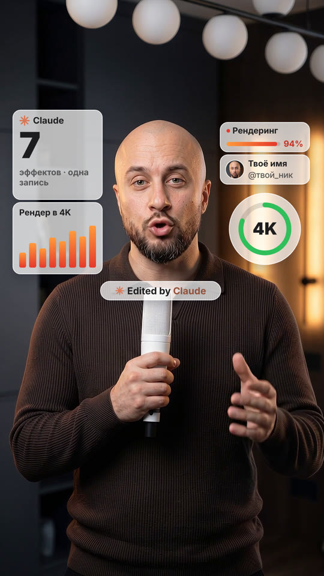
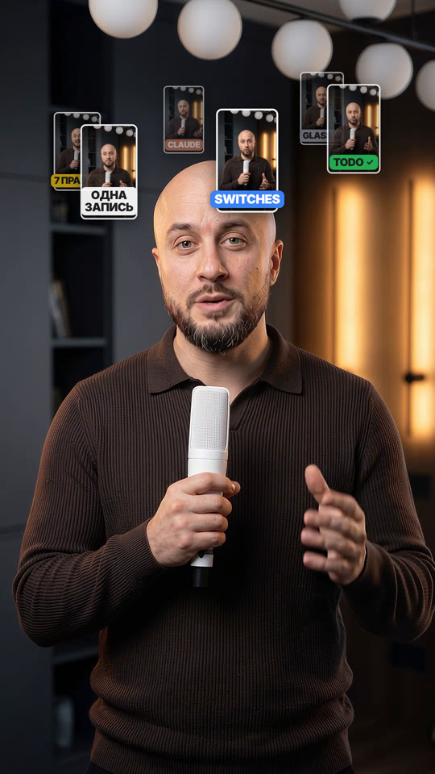
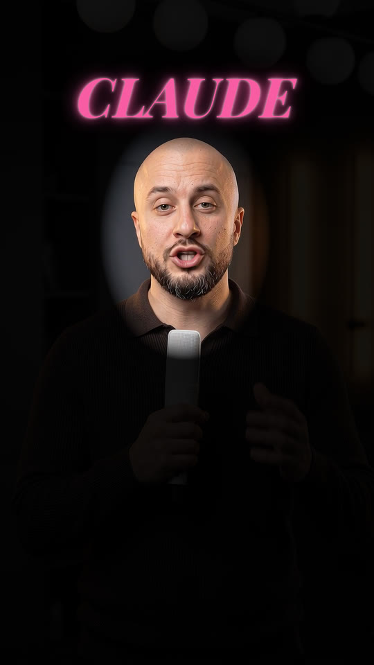
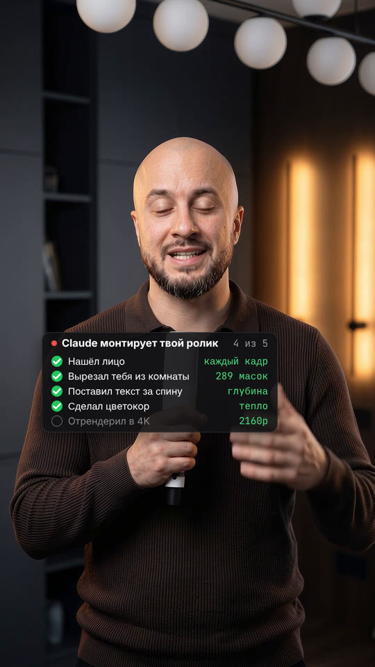
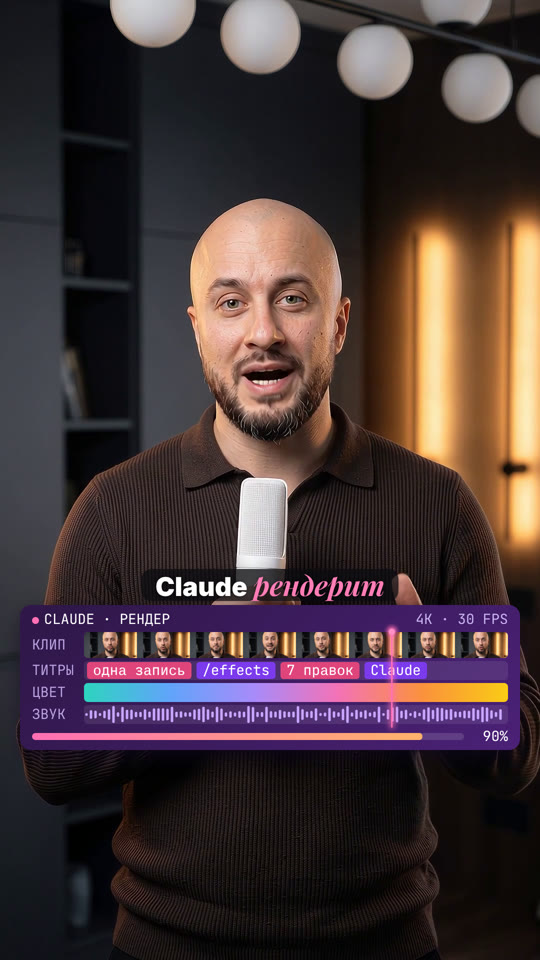
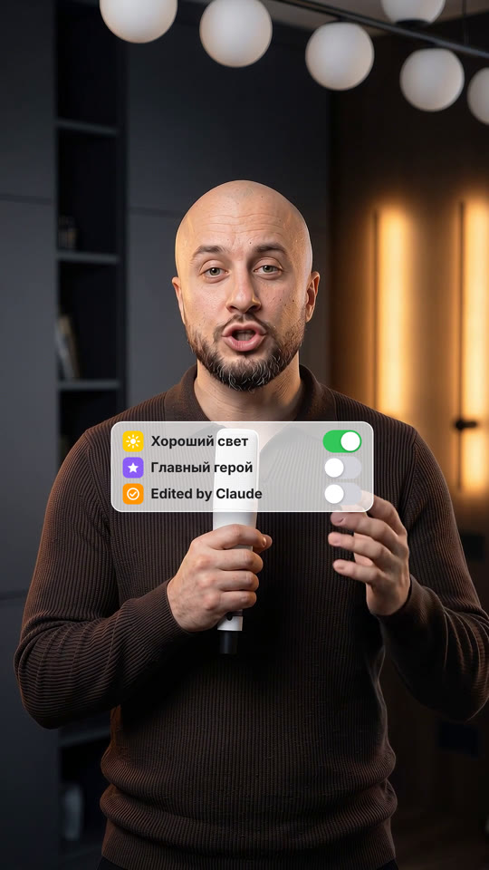

# Эффекты на видео одной командой

Ты записываешь себя один раз. ИИ-агент ставит поверх записи графику: стеклянные панели, список задач с галочками, монтажную дорожку. Монтажная программа не нужна.

Это набор для агента: Claude Code, Codex и других, которые работают с файлами на компьютере. Агент ставит всё сам.

## Как начать

1. Скачай эту папку: зелёная кнопка **Code → Download ZIP**, распакуй.
2. Открой папку в своём агенте.
3. Напиши агенту: **«Прочитай AGENTS.md и выполни всё, что там написано»**.

Агент проверит программы, поставит навык и попросит у тебя запись.

## Команды

| Команда | Что будет в кадре |
| --- | --- |
| `/effects glass-widgets` | стеклянные панели парят вокруг головы |
| `/effects orbit` | обложки твоих роликов кружат вокруг головы |
| `/effects spotlight` | комната гаснет, ты остаёшься в луче света |
| `/effects todo` | список задач: галочки ставятся, пока ты говоришь |
| `/effects timeline` | внизу едет монтажная дорожка со светящимся бегунком |
| `/effects match-cut` | быстрая смена газетных полос, одно слово стоит на месте |
| `/effects toggles` | под лицом включаются переключатели, как в айфоне |

Можно и без команды, словами: «поставь список задач на фразу про три шага».

| | | | |
| --- | --- | --- | --- |
|  |  |  |  |
| `glass-widgets` | `orbit` | `spotlight` | `todo` |
|  |  |  | |
| `timeline` | `match-cut` | `toggles` | |

## Что нужно

- Компьютер с агентом. Сайт в браузере не подойдёт: оттуда агент не видит твои файлы.
- Вертикальная запись, где ты говоришь в камеру.
- Программы Node.js, FFmpeg и Python: агент проверит их и подскажет, как поставить.

Платных сервисов и ключей не нужно. Эффекты собираются на твоём компьютере открытым инструментом [HyperFrames](https://github.com/heygen-com/hyperframes).

## Правки

Пиши агенту как монтажёру: «панель ниже», «галочки быстрее», «другой текст». Он поправит и покажет кадр.

## Свой эффект

Каждый эффект — один файл в `skills/effects/templates/`. Как он устроен и как добавить свой, написано в `skills/effects/references/contract.md`.

## Лицензия

MIT. Набор сделан в клубе [Хардкодинг PRO](https://hardcoding.proaicommunity.online/learn/).
